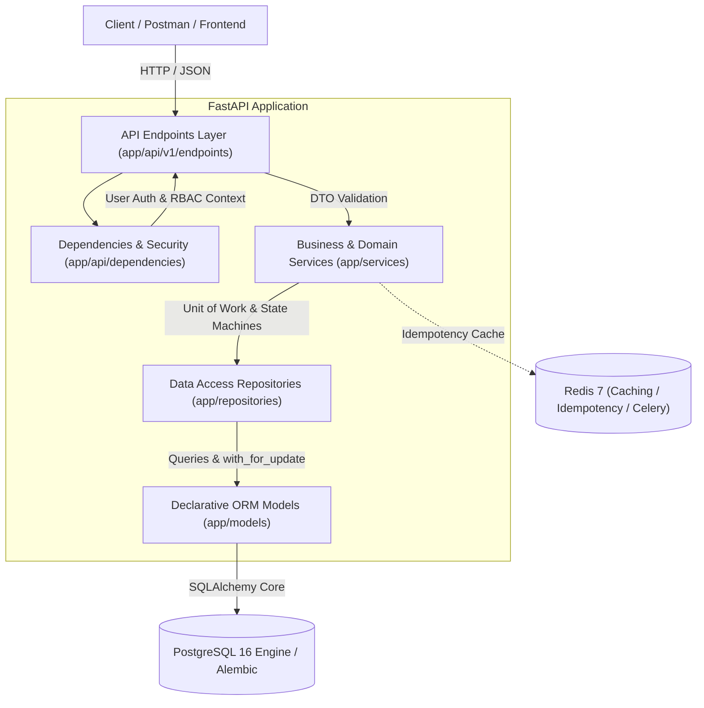
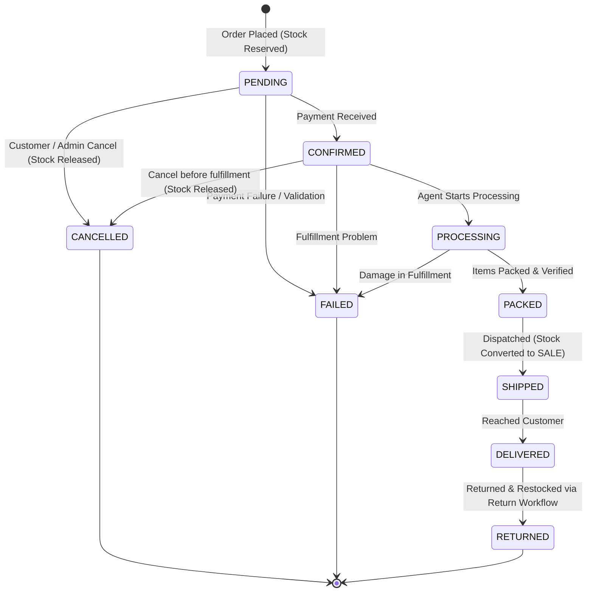
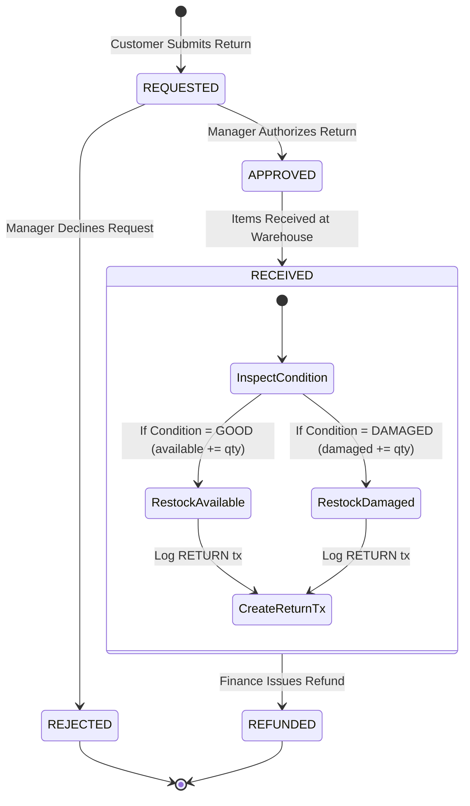

# Architecture & System Design Documentation

## 1. Clean 5-Tier Architecture

The system follows a strict 5-tier architecture separating concerns and preventing domain logic leakage into route handlers:

### Layer Responsibilities
1. **API Endpoints (`app/api/v1/endpoints/`)**:
   - Parses HTTP requests and injects dependencies.
   - Delegates all business execution to service classes.
   - Envelopes responses using Pydantic DTOs (`SuccessResponse[T]`, `PaginatedResponse[T]`).
2. **Dependencies (`app/api/dependencies/`)**:
   - JWT validation, user retrieval, account status checks (`is_active`).
   - Role-Based Access Control (`require_role(...)`).
   - Idempotency key extraction.
   - Server-side pagination parameter binding.
3. **Services (`app/services/`)**:
   - Contains 100% of domain business logic, state machine validation, financial calculations, and inventory reservation.
   - Orchestrates atomic database transactions, audit logging, and notifications.
4. **Repositories (`app/repositories/`)**:
   - Encapsulates database queries, row-level locking (`with_for_update()`), joins, and pagination.
5. **Models (`app/models/`)**:
   - SQLAlchemy Declarative models with schema constraints (`CheckConstraint`, `UniqueConstraint`, foreign keys).

---

## 2. Order Fulfillment State Machine

Every order follows a deterministic state machine. Invalid transitions are strictly rejected with `INVALID_ORDER_STATUS`.

### Transition Actions:
- **`PENDING` Creation**: Atomically reserves inventory (`available -= qty`, `reserved += qty`), logs `RESERVATION` transaction.
- **`SHIPPED` Transition**: Converts reserved stock into permanent `SALE` (`reserved -= qty`), logs `SALE` transaction.
- **`CANCELLED` Transition**: Releases reserved stock (`available += qty`, `reserved -= qty`), logs `RELEASE` transaction.
- **`DELIVERED` -> Return**: Customer requests return; upon warehouse receipt, stock is restocked as available or marked damaged with a `RETURN` transaction.

---

## 3. Customer Return Workflow

---

## 4. Role-Based Authorization (RBAC) Matrix

| Resource / Endpoint | Admin | Warehouse Manager | Fulfillment Agent | Customer |
|---|---|---|---|---|
| User Management / Me | Full | Own Profile | Own Profile | Own Profile |
| Create / Update Products | Yes | Read Only | Read Only | Read Only |
| Activate / Deactivate Products | Yes | No | No | No |
| Create Warehouses | Yes | No | No | No |
| Update Warehouse | Yes | Authorized Only | No | No |
| Inventory Adjustments | Yes | Authorized Only | No | No |
| Inter-Warehouse Transfers | Yes | Authorized Only | No | No |
| View Inventory | All Warehouses | Authorized Warehouses | Authorized Warehouses | No |
| Create Order | Yes | No | No | Yes |
| Cancel Order | Yes | Authorized Only | No | Own Order (Pending/Confirmed) |
| Fulfillment Workflow (Process/Pack/Ship/Deliver) | Yes | Authorized Only | Authorized Only | No |
| Assign Order to Agent | Yes | Authorized Only | No | No |
| Request Return | No | No | No | Own Delivered Orders |
| Approve / Process Return | Yes | Authorized Only | No | No |
| Audit Logs | Full Access | No | No | No |
| Dashboard | Admin Analytics | Warehouse Metrics | No | Customer Spending & Orders |
