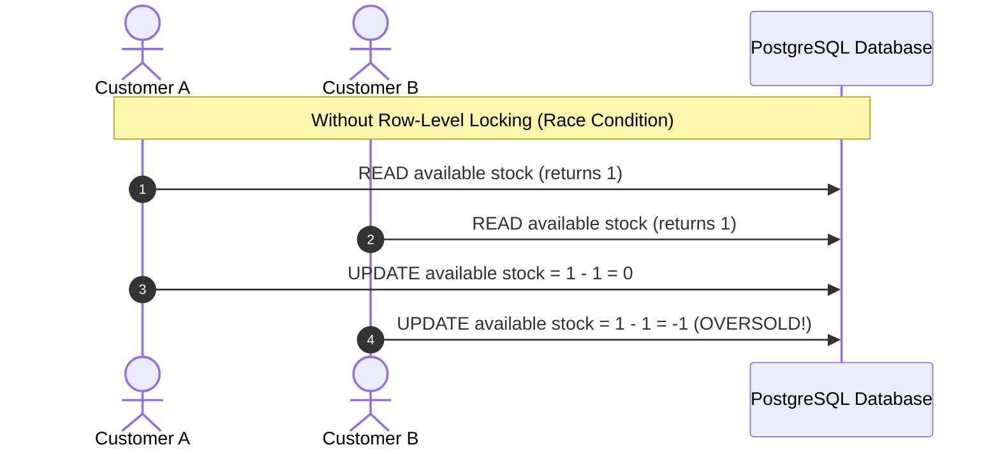

# Concurrency, Transactions & Idempotency Strategy

## 1. The Concurrency Challenge: Preventing Overselling

In modern order fulfillment systems, high-traffic events (e.g., flash sales, limited drops) present a classic race condition:
- Product X has **1 unit** left in stock at Warehouse A.
- Customer 1 and Customer 2 concurrently submit orders for 1 unit of Product X at the exact same millisecond.
- **Without concurrency controls**: Both requests read `available_quantity = 1`, both approve the order, stock becomes `-1` (oversold), leading to fulfillment failure and financial inconsistency.



---

## 2. Solution: Row-Level Locking (`SELECT ... FOR UPDATE`)

To guarantee strict serializability without paying the heavy throughput penalty of table locks or serializable transaction isolation, our platform employs **Row-Level Pessimistic Locking**:

```python
# app/repositories/inventory_repository.py
stmt = (
    select(Inventory)
    .where(Inventory.product_id == product_id, Inventory.warehouse_id == warehouse_id)
    .with_for_update()  # <-- Generates: SELECT ... FOR UPDATE
)
inv = db.scalar(stmt)
```

### How PostgreSQL Executes This:
1. When Customer A's transaction reads the inventory row with `FOR UPDATE`, PostgreSQL acquires an **Exclusive Row Lock** on that row.
2. When Customer B's concurrent transaction attempts to read the same inventory row with `FOR UPDATE` or mutate it, PostgreSQL blocks Customer B's worker at the database level until Customer A commits or rolls back.
3. Once Customer A commits:
   - `available_quantity` drops from 1 to 0.
   - The lock is released.
   - Customer B's query unblocks and reads the **fresh committed state** (`available_quantity = 0`).
   - Customer B's check `inv.available_quantity < req.quantity` triggers, immediately rejecting with `INSUFFICIENT_INVENTORY`.

```mermaid
sequenceDiagram
    autonumber
    actor Customer_A as Customer A
    actor Customer_B as Customer B
    participant DB as PostgreSQL Database

    Note over Customer_A, DB: With Row-Level Locking (with_for_update)
    Customer_A->>DB: BEGIN TX; SELECT ... FOR UPDATE (Acquires Exclusive Lock)
    Customer_B->>DB: BEGIN TX; SELECT ... FOR UPDATE (Blocked by Lock...)
    Customer_A->>DB: Check stock (1 >= 1); available -= 1; reserved += 1
    Customer_A->>DB: COMMIT TX (Lock Released!)
    Note over DB, Customer_B: Customer B's query resumes
    DB-->>Customer_B: Returns row with updated stock (available = 0)
    Customer_B->>Customer_B: Evaluates (0 < 1) -> Raises InsufficientInventoryError
    Customer_B->>DB: ROLLBACK TX
```

---

## 3. Deadlock Prevention Strategy

When orders contain multiple items, concurrent orders locking rows in different orders could cause a classic database deadlock:
- **Order 1**: locks Product A, then attempts to lock Product B.
- **Order 2**: locks Product B, then attempts to lock Product A.
- Both block each other indefinitely, causing a deadlock exception.

### Solution: Deterministic Lock Ordering
Before acquiring row locks, our `OrderService` and `InventoryService` sort all item product IDs in ascending numerical order:

```python
# app/services/order_service.py
sorted_items = sorted(req.items, key=lambda x: x.product_id)
for item_in in sorted_items:
    inv = self.inventory_repo.get_inventory(item_in.product_id, warehouse.id, for_update=True)
```
Because all concurrent transactions always acquire locks in the exact same resource order (`P1 -> P2 -> P3`), circular wait conditions are mathematically impossible. Deadlocks are completely eliminated.

---

## 4. Multi-Layered Safety Nets

1. **Application Layer**: Explicit validation against available stock in `OrderService`.
2. **Locking Layer**: Database row-level locks via `with_for_update()`.
3. **Database Constraint Layer**: Check constraint `chk_available_qty_non_negative`:
   ```sql
   CONSTRAINT chk_available_qty_non_negative CHECK (available_quantity >= 0)
   ```
   Even if a developer bypassed the service layer, the database engine will reject any SQL query that attempts to drive `available_quantity` below 0.

---

## 5. Idempotency Guarantees

Network retries and mobile reconnects can cause duplicate POST requests. Our platform implements RFC-compliant idempotency across all mutating operations:
- `POST /api/orders`
- `POST /api/orders/{id}/payment`
- `POST /api/inventory/adjust`
- `POST /api/inventory/transfer`

### Workflow:
1. Client sends an `Idempotency-Key` header with a unique UUID.
2. The server hashes the request method, path, and payload (`SHA-256(endpoint + ":" + body_bytes)`).
3. `IdempotencyService` checks the `idempotency_keys` table:
   - **Key Found & Hash Matches**: Replays the cached HTTP status code and response payload immediately without touching inventory or creating duplicate entities.
   - **Key Found & Hash Differs**: Rejects with `409 Conflict` (`DUPLICATE_IDEMPOTENCY_KEY`) to prevent payload tampering.
   - **Key Not Found**: Executes business logic within a transaction and caches the response for 24 hours.

---

## 6. Verification & Automated Concurrency Tests

This strategy is proven by `tests/test_concurrency_locking.py`:
- 5 concurrent worker threads simultaneously compete for **5 units** of inventory.
- Each thread demands **2 units** (total demand = 10 units).
- **Result**: Exactly 2 orders succeed (reserving 4 units, leaving 1 unit available), and 3 orders are safely rejected with `INSUFFICIENT_INVENTORY`.
- Stock balance remains strictly valid (`available_quantity = 1, reserved_quantity = 4`). No race conditions. Zero negative stock.
