# Database Entity Relationship (ER) Diagram & Schema Specification

## 1. Overview
The **Order Fulfillment & Inventory Management Platform** database is designed with high data integrity, strict referential constraints, concurrency safety, and auditability. It implements 14 normalized tables using PostgreSQL/SQLAlchemy.

---

## 2. Mermaid Entity-Relationship Diagram

```mermaid
erDiagram
    USERS ||--o{ REFRESH_TOKENS : "issues"
    USERS ||--o{ WAREHOUSE_USERS : "assigned to"
    USERS ||--o{ ORDERS : "places as customer"
    USERS ||--o{ ORDER_ASSIGNMENTS : "assigned as agent"
    USERS ||--o{ NOTIFICATIONS : "receives"
    USERS ||--o{ AUDIT_LOGS : "triggers"

    WAREHOUSES ||--o{ WAREHOUSE_USERS : "staffed by"
    WAREHOUSES ||--o{ INVENTORY : "stores"
    WAREHOUSES ||--o{ INVENTORY_TRANSACTIONS : "logs movements"
    WAREHOUSES ||--o{ ORDERS : "fulfills"

    CATEGORIES ||--o{ PRODUCTS : "classifies"
    PRODUCTS ||--o{ INVENTORY : "stocked in"
    PRODUCTS ||--o{ INVENTORY_TRANSACTIONS : "tracked in"
    PRODUCTS ||--o{ ORDER_ITEMS : "included in"
    PRODUCTS ||--o{ RETURN_ITEMS : "returned in"

    ORDERS ||--|{ ORDER_ITEMS : "contains"
    ORDERS ||--o{ ORDER_STATUS_HISTORY : "tracks transitions"
    ORDERS ||--o{ ORDER_ASSIGNMENTS : "assigned through"
    ORDERS ||--o{ RETURNS : "generates"

    RETURNS ||--|{ RETURN_ITEMS : "itemizes"

    USERS {
        int id PK
        string email UK
        string username UK
        string hashed_password
        string full_name
        string role "ADMIN, WAREHOUSE_MANAGER, FULFILLMENT_AGENT, CUSTOMER"
        boolean is_active
        timestamp created_at
        timestamp updated_at
    }

    REFRESH_TOKENS {
        int id PK
        int user_id FK
        string token_jti UK
        string family_id
        boolean is_revoked
        timestamp expires_at
        timestamp created_at
    }

    WAREHOUSES {
        int id PK
        string name UK
        string location
        string status "ACTIVE, INACTIVE"
        int capacity
        timestamp created_at
        timestamp updated_at
    }

    WAREHOUSE_USERS {
        int id PK
        int warehouse_id FK
        int user_id FK
        timestamp assigned_at
    }

    CATEGORIES {
        int id PK
        string name UK
        text description
        timestamp created_at
        timestamp updated_at
    }

    PRODUCTS {
        int id PK
        string sku UK
        string name
        text description
        int category_id FK
        numeric price
        numeric cost_price
        string status "ACTIVE, INACTIVE"
        timestamp created_at
        timestamp updated_at
    }

    INVENTORY {
        int id PK
        int product_id FK
        int warehouse_id FK
        int available_quantity "CHECK >= 0"
        int reserved_quantity "CHECK >= 0"
        int damaged_quantity "CHECK >= 0"
        int reorder_level
        timestamp updated_at
    }

    INVENTORY_TRANSACTIONS {
        int id PK
        int product_id FK
        int warehouse_id FK
        string transaction_type "PURCHASE, SALE, RESERVATION, RELEASE, ADJUSTMENT, TRANSFER_IN, TRANSFER_OUT, RETURN, DAMAGE"
        int quantity
        string reference_entity
        string reference_id
        int user_id FK
        timestamp timestamp
        json metadata_json
    }

    ORDERS {
        int id PK
        string order_number UK
        int customer_id FK
        int warehouse_id FK
        int assigned_agent_id FK
        numeric subtotal
        numeric discount
        numeric tax
        numeric total_amount
        string status "PENDING, CONFIRMED, PROCESSING, PACKED, SHIPPED, DELIVERED, CANCELLED, FAILED, RETURNED"
        string payment_status "UNPAID, PENDING, PAID, REFUNDED, FAILED"
        timestamp expected_delivery_date
        text notes
        timestamp created_at
        timestamp updated_at
    }

    ORDER_ITEMS {
        int id PK
        int order_id FK
        int product_id FK
        int quantity "CHECK > 0"
        numeric unit_price
        numeric discount
        numeric tax
        numeric total
    }

    ORDER_STATUS_HISTORY {
        int id PK
        int order_id FK
        string old_status
        string new_status
        int changed_by_id FK
        text notes
        timestamp timestamp
    }

    ORDER_ASSIGNMENTS {
        int id PK
        int order_id FK
        int agent_id FK
        int assigned_by_id FK
        text notes
        timestamp assigned_at
    }

    RETURNS {
        int id PK
        string return_number UK
        int order_id FK
        int customer_id FK
        int warehouse_id FK
        text reason
        string status "REQUESTED, APPROVED, REJECTED, RECEIVED, REFUNDED"
        text admin_notes
        timestamp created_at
        timestamp updated_at
    }

    RETURN_ITEMS {
        int id PK
        int return_id FK
        int product_id FK
        int quantity "CHECK > 0"
        string condition "GOOD, DAMAGED"
        boolean restocked
    }

    NOTIFICATIONS {
        int id PK
        int user_id FK
        string type
        string title
        text message
        string reference_entity
        string reference_id
        boolean is_read
        timestamp created_at
    }

    AUDIT_LOGS {
        int id PK
        int user_id FK
        string action
        string entity
        string entity_id
        timestamp timestamp
        string ip_address
        json metadata_json
    }

    IDEMPOTENCY_KEYS {
        int id PK
        string key UK
        string endpoint
        int user_id FK
        string request_hash
        int response_code
        text response_body
        timestamp created_at
        timestamp expires_at
    }
```

---

## 3. Schema Design Highlights & Constraints

### 3.1 Unique Constraints
- `users`: `email`, `username`
- `warehouses`: `name`
- `warehouse_users`: `(warehouse_id, user_id)` (prevents duplicate assignments)
- `products`: `sku`
- `inventory`: `(product_id, warehouse_id)` (one record per warehouse-product pair)
- `orders`: `order_number`
- `returns`: `return_number`
- `idempotency_keys`: `key`

### 3.2 Check Constraints (Database-Level Invariants)
- `chk_available_qty_non_negative`: `available_quantity >= 0` (Prevents overselling under any circumstance)
- `chk_reserved_qty_non_negative`: `reserved_quantity >= 0`
- `chk_damaged_qty_non_negative`: `damaged_quantity >= 0`
- `chk_order_item_qty_positive`: `quantity > 0`
- `chk_return_item_qty_positive`: `quantity > 0`

### 3.3 Immutability by Design
- **`inventory_transactions`**: Acts as an append-only accounting ledger. Never updated or deleted.
- **`audit_logs`**: Permanent compliance record of all mutations, logins, and status transitions.
- **`order_items`**: Records fixed `unit_price` at the instant order was created. Subsequent product price changes never alter historical order items.
